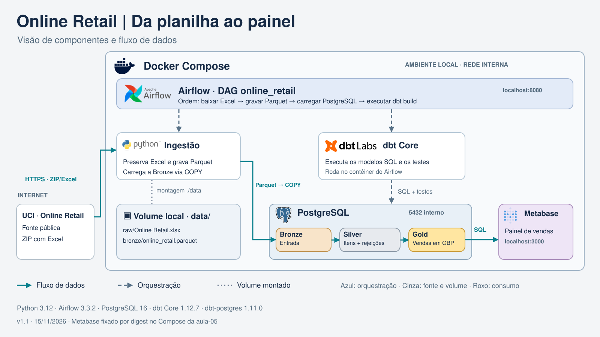

# Engenharia de Dados na Prática

## Arquitetura da pipeline

Visão da pipeline completa, da ingestão na Aula 3 ao painel no Metabase na Aula 5.



[Arquivo editável do Draw.io](docs/arquitetura-pipeline.drawio)

## Aula 3 — Ingestão com Python e Airflow

Baixamos a base real **Online Retail**, preservamos o Excel original e gravamos seus dados em Parquet na camada Bronze. Não há limpeza, deduplicação ou dados simulados nesta aula.

### Executar pelo Airflow

Com Docker e Docker Compose instalados:

```bash
docker compose up --build -d
docker compose logs -f airflow
```

A primeira construção pode demorar. Espere o Airflow iniciar e abra [localhost:8080](http://localhost:8080). Use `Ctrl+C` para sair da exibição dos logs sem parar o serviço.

Consulte o usuário e a senha local gerados pelo Airflow:

```bash
docker compose exec airflow cat /opt/airflow/simple_auth_manager_passwords.json.generated
```

Na interface, habilite a DAG **online_retail**, clique em **Trigger** e acompanhe as tarefas **baixar_excel** e **salvar_parquet** e seus logs.

A DAG usa TaskFlow com dependência explícita:

```python
baixar = task(baixar_excel)()
salvar = task(salvar_parquet)()

baixar >> salvar
```

`task(funcao)` é a forma de aplicar `@task` a uma função importada, sem criar uma função intermediária. Os parênteses registram as tarefas; a execução fica a cargo do Airflow. `baixar >> salvar` faz a conversão esperar o download terminar. `dag = online_retail()` constrói a DAG decorada com `@dag`, sem executar a ingestão.

Todos os imports ficam no topo. As tarefas usam o Excel no diretório compartilhado, sem passagem de dados por XCom.

O serviço usa Airflow 3.3.2 em modo `standalone`, com estado persistido em `.airflow/`. É um ambiente didático local, não uma configuração de produção. A porta fica acessível apenas na própria máquina.

Para parar sem apagar os dados:

```bash
docker compose down
```

### Fonte e licença dos dados

Chen, D. (2015). **Online Retail**. UCI Machine Learning Repository. [DOI: 10.24432/C5BW33](https://doi.org/10.24432/C5BW33). Dados de um varejista britânico, de dezembro de 2010 a dezembro de 2011. Licença dos dados: [CC BY 4.0](https://creativecommons.org/licenses/by/4.0/).

Os preços estão em libras esterlinas; a base não informa confirmação de pagamento. Ela é um arquivo histórico obtido por HTTP, não uma API de pedidos.

Referências: [dataset e dicionário](https://archive.ics.uci.edu/dataset/352/online%2Bretail), [Airflow standalone](https://airflow.apache.org/docs/apache-airflow/3.3.2/start.html), [TaskFlow](https://airflow.apache.org/docs/apache-airflow/3.3.2/tutorial/taskflow.html) e [dependências explícitas](https://airflow.apache.org/docs/apache-airflow/3.3.2/core-concepts/dags.html#task-dependencies).
